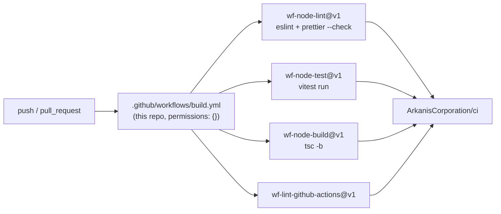

# dcsh — repo-standards baseline + JS → TypeScript migration

Status: draft for review · Issue: [ARK-601](https://linear.app/arkanis/issue/ARK-601) · Follow-up: [ARK-602](https://linear.app/arkanis/issue/ARK-602)

## Overview

Bring `dcsh` (a ~490-line Discord REST shell, currently plain-JS ESM) onto the Arkanis
Node/TypeScript repo baseline so it can go public: migrate to TypeScript, switch to pnpm, adopt the
shared Renovate preset and shared CI workflows, add lint/format/test tooling, and enforce
Conventional Commits. The source is small, clean, and already leans on the fully-typed
`discord-api-types`, so the migration is cheap now and high-value for a public tool.

Scope is the toolchain and a mechanical language port. **No behaviour change** to the shell: same
commands, same guards, same token-source precedence, same config format.

> Diagram: how the CI consumer workflow fans out to the shared Arkanis reusable workflows.

<details>
<summary>CI workflow structure</summary>



</details>

## Description

### Why

`dcsh` is the only would-be JS outlier among Arkanis Node projects — every sibling
(`repo-standards`, `agent-harness`) is TypeScript + vitest. Going public means matching the
baseline the `repo-standards` scorecard measures, and TypeScript specifically pays off here: the
whole tool is a thin guarded wrapper over `discord-api-types` Routes, so types turn the token-source
union, the read-only/reason guard, and Route usage into checked code.

### What changes

**Language.** `bin/dcsh.js` + `src/*.js` → TypeScript. Compiled with `tsc` to `dist/`; the published
`bin` points at `dist/bin/dcsh.js` (tsc preserves the `#!` shebang). No runtime `tsx` dependency —
dev convenience only. Mirrors `agent-harness` (`tsc -b`, `node dist/...`).

New/typed shapes (these also become the seam ARK-602 builds on):

- `TokenSource` — discriminated union over `command | env | file | prompt`.
- `Config` / `Profile` — the config-file schema, replacing the ad-hoc `raw` object.
- `Statement` — the parsed-command grammar (`cmd` + `arg`), typed against `KEYWORDS` /
  `SHOW_TARGETS`. This is the typed command schema the parser and completer will share.
- `GuardedApi` — the frozen `{ get, post, put, patch, delete }` surface `Session.api` exposes.
- `Session` fields typed against `discord-api-types` result types (`me`, `guild`, guild list).

**Package manager.** npm → **pnpm**. Add `packageManager`, generate `pnpm-lock.yaml`, delete
`package-lock.json`. Bump `engines.node` to `>=22` (CI runs node 24.x).

**Renovate.** Add `renovate.json5` extending `github>ArkanisCorporation/renovate-config`
(reviewers `team:devops`), matching `repo-standards`.

**CI.** `.github/workflows/build.yml` consuming the shared reusable workflows at `@v1`
(`wf-node-lint`, `wf-node-test`, `wf-node-build`, `wf-lint-github-actions`) with
`package-manager: pnpm`, `node-version: 24.x`, caching on. Top-level `permissions: {}`, per-job
least privilege, any third-party action pinned to a commit SHA.

**Lint / format.** typescript-eslint flat config + prettier (2-space, the Node norm and what
`agent-harness` uses). Scripts: `lint`, `format`, `format:check`. `wf-node-lint` runs these.

**Tests.** vitest baseline over the pure and guard logic, where the payoff is highest and REST
mocking is light:

- `parse()` — statement vs JS disambiguation (`show servers` parses; `show(x)`, `reason.length` do not).
- Token precedence — `pickTokenSource` flag > profile > `$DISCORD_TOKEN` > prompt; `clean()`
  stripping `Bot ` and rejecting whitespace/empty; `describeSource`.
- `loadConfig` — rejects literal tokens / missing source key; accepts each valid source shape.
- The mutation guard — `Session.api` blocks mutations in read-only, requires a reason, formats
  `[dcsh:<operator>] <reason>` truncated to 512 (with `@discordjs/rest` mocked).

Network-dependent paths (`use`, `listGuilds`, `show channels/roles/members`) are left for a later
pass unless cheap to mock; the baseline does not chase coverage for its own sake.

**Version control hygiene.** Conventional Commits via a husky `commit-msg` hook (commitlint),
mirroring `repo-standards`. Add `.gitattributes` (line-ending normalisation, `eol=lf`). AGENTS.md /
README touch-ups for the new toolchain.

### Decisions (with recommendations)

1. **`.editorconfig`: do not adopt the central .NET file.** The org's central `.editorconfig` is the
   RehanSaeed .NET template — 4-space default, heavily C#-oriented. It directly conflicts with
   prettier's 2-space Node convention (and the existing code), which is exactly why **every** Node
   repo on the scorecard shows `.editorconfig` ❌. Recommendation: skip the .NET central file; let
   **prettier be the formatting authority** (as every Node sibling does), and add only a minimal
   editor-baseline `.editorconfig` (utf-8, lf, final newline, 2-space) if wanted. Consequence: that
   scorecard column stays ❌/— for dcsh, consistent with all Node siblings. *This is the one choice
   where dcsh deliberately diverges from a literal scorecard cell; flagging it explicitly.*

2. **Compiled `dist/` over runtime `tsx`.** A published npm CLI should not pay a `tsx` startup cost
   or carry it as a runtime dep. Build on `prepare`/`prepublishOnly`; `bin` → `dist`.

3. **Single PR vs stacked.** The work has honest dependency layers (language port → tooling →
   CI). Candidate 2-layer stack: (a) TS migration + pnpm + lint/format/test, (b) Renovate + CI +
   VC hygiene. Decide at plan time; default to a stack if layer (a) is reviewable alone.

### Out of scope

- Autosuggestions / IntelliSense completion — [ARK-602](https://linear.app/arkanis/issue/ARK-602).
  This spec only keeps the completer a **swappable seam** (one typed command schema, completer
  isolated from the REPL wiring) so that work slots in without a rewrite.
- Any change to shell behaviour, command surface, or config format.
- Publishing to npm / flipping the repo public — a follow-up once the baseline is green.

## Details

<details>
<summary>Current layout and target layout</summary>

Current: `bin/dcsh.js`, `src/config.js`, `src/session.js`, `src/commands.js`, `package.json`
(npm, `type: module`, `engines.node >=20.6`), `package-lock.json`, `README.md`, `.gitignore`.

Target adds/changes:

```
bin/dcsh.ts
src/{config,session,commands}.ts
src/types.ts                 # shared TokenSource / Config / Statement / GuardedApi
tsconfig.json                # NodeNext, strict, target ES2022, outDir dist
eslint.config.js             # typescript-eslint flat config
.prettierrc / prettier via config
vitest.config.ts
tests/*.test.ts
renovate.json5
.github/workflows/build.yml
.gitattributes
.husky/commit-msg            # commitlint
commitlint.config.js
package.json                 # pnpm packageManager, bin -> dist, build/lint/test/format scripts, engines >=22
pnpm-lock.yaml               # replaces package-lock.json
dist/                        # gitignored build output
```

</details>

<details>
<summary>Canonical references consulted</summary>

- `ArkanisCorporation/ci` → `examples/node-pnpm/README.md` (consumer workflow shape: pnpm, node 24.x),
  `renovate.jsonc` (`extends: github>ArkanisCorporation/renovate-config`, `reviewers: team:devops`),
  the four `wf-node-*` / `wf-lint-github-actions` reusable workflows + their input schemas.
- `ArkanisCorporation/repo-standards` → scorecard Node/TypeScript section (tracked columns), its own
  TS + vitest + husky + `renovate.json5` setup.
- `ArkanisCorporation/agent-harness` → `package.json` as the TS-Node exemplar (`tsc -b` build,
  `node dist/...` start, vitest, prettier, husky 9, lint-staged, `@types/node` 24, typescript 5.9).

Note: `ci/.gitattributes` was not present at fetch time (404); use `repo-standards`' or a standard
`text=auto eol=lf` file during implementation.

</details>
